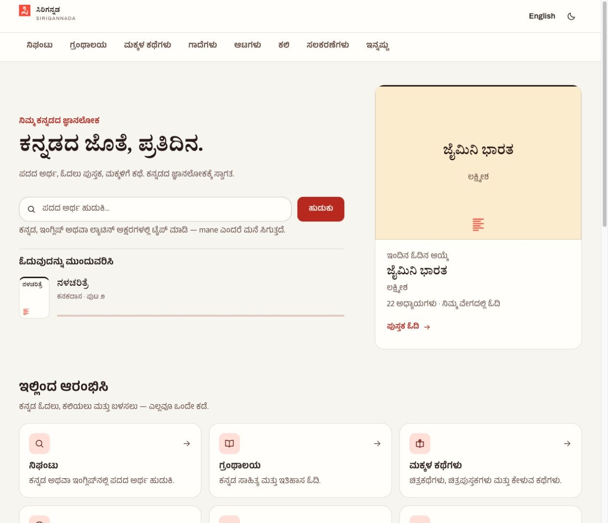
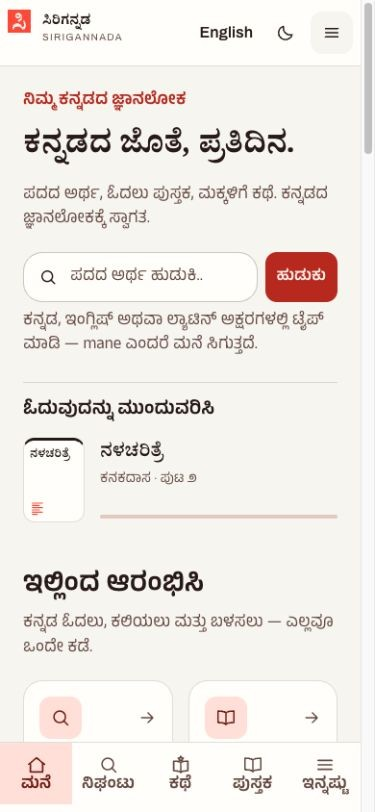
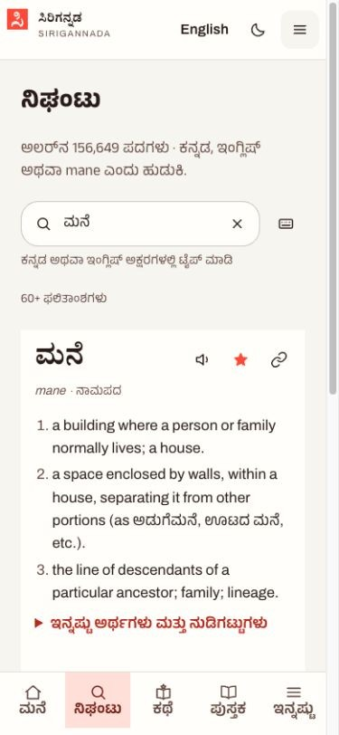
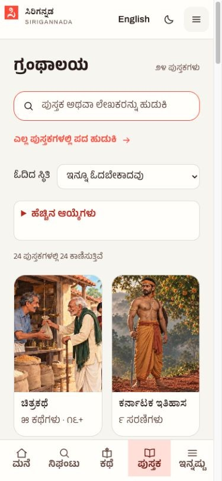

# ಸಿರಿಗನ್ನಡ · Sirigannada

**ಕನ್ನಡದ ಜೊತೆ, ಪ್ರತಿದಿನ. · A little more Kannada, every day.**

A Kannada-first home for word meanings, classic literature, children's stories, learning and games.
Free to use, with no account, ads or tracking scripts. Available in Kannada and English, on phones and computers.

**[Open Sirigannada](https://www.sirigannada.in)**

## ಒಂದು ನೋಟ · A look inside



<p>
  
  
  
</p>

Screenshots updated **5 November 2026**. Daily selections and saved reading progress vary by date and device.

## ಆರಂಭಿಸಿ · Start here

- **Phone:** the bottom bar opens Home, Dictionary, Children's stories, Library and More. The header's section menu also reaches Proverbs, Games, Learn and Tools.
- **Computer:** use the section navigation below the header.
- **Language and theme:** available in the header on both screen sizes.
- **Home:** search for a word, resume a book, or choose a destination. “Continue reading” returns to your latest unfinished classic; “Today's reading pick” suggests an unstarted, unfinished book and hides when none remain.

## ಏನಿದೆ? · What is in the app?

Catalogue snapshot: **5 November 2026**.

| Section | What you can do |
|---|---|
| [ನಿಘಂಟು · Dictionary](https://www.sirigannada.in/dictionary) | Search **156,649 Alar entries** in Kannada, English or Latin letters. |
| [ಗ್ರಂಥಾಲಯ · Library](https://www.sirigannada.in/library) | Read **24 classics**, plus illustrated story and Karnataka history collections. |
| [ಮಕ್ಕಳ ಕಥೆಗಳು · Children's stories](https://www.sirigannada.in/children) | Explore Panchatantra and folk retellings, and **967 picture books**, including **93 with narration**. |
| [ಗಾದೆಗಳು · Proverbs](https://www.sirigannada.in/proverbs) | Browse **2,194 source sayings** by search or letter; punctuation-only variants are grouped. |
| [ಕಲಿ · Learn](https://www.sirigannada.in/learn) | Explore the alphabet, letter recognition, word meanings, gunitakshara and favourite-word practice. |
| [ಆಟಗಳು · Games](https://www.sirigannada.in/games) | Play the daily Kannada word game and Kannada/English crosswords. |
| [ಸಲಕರಣೆಗಳು · Tools](https://www.sirigannada.in/tools) | Transliterate, convert numbers or Nudi/Baraha text, check text and manage offline storage. |
| [ನನ್ನ ಸಂಗ್ರಹಗಳು · Collections](https://www.sirigannada.in/collections) | Keep words, verses and proverbs together on your device; import or export collections. |

### ನಿಘಂಟು · Find a meaning

1. Search for `ಮನೆ`, `house`, or `mane` from Home or Dictionary.
2. Read the first meanings; expand **More meanings and idioms** for longer entries.
3. Tap the star to save a word. **View saved words** opens Collections; favourites also appear when dictionary search is empty.
4. Copy a word's link or share an image card. Dictionary data is [Alar](https://alar.ink) by V. Krishna, under ODbL 1.0.

### ಗ್ರಂಥಾಲಯ · Choose a book and keep your place

1. Search by title or author. Choose **Unread**, **Finished**, or **All books**; open **More filters** for literary form and reset controls.
2. Open a classic. Turn pages with the buttons, use the page slider, or open the chapter list. Tap a word for its meaning.
3. On a phone, **Book actions** groups the additional reader controls. Verses can be saved, linked or shared.
4. Return to the catalogue without losing its search, filter, loaded batch or scroll position in the same tab.
5. Books can be marked finished or unread. Reading status and progress stay on this device; finished books remain available under Finished or All books.
6. Use **Save all for offline** to keep the classics available without a connection.

Book cards use credited original photographs or title covers. Originally monochrome photographs stay monochrome.
Author, source and licence details are available on [Credits](https://www.sirigannada.in/credits).

### ಮಕ್ಕಳ ಕಥೆಗಳು · Read with children

The children's hub has four collections:

- **ಪಂಚತಂತ್ರ ಕಥೆಗಳು:** illustrated Kannada retellings with age guidance.
- **ಜಾನಪದ ಕಥೆಗಳು:** folk retellings, including ಪುಣ್ಯಕೋಟಿ.
- **ಕೇಳಿ ಓದಿ:** narrated picture books for listening and reading together.
- **ಚಿತ್ರಪುಸ್ತಕಗಳು:** picture books for independent reading.

Search picture books, choose a reading status, and open **More filters** for reading levels.
Levels describe reading difficulty rather than age. Start with Level 1 and try higher levels for more text.
**Show more books** expands the catalogue in batches. Turn pages in the reader and use the back link to return to the appropriate collection.
Save books while online before using them offline.

### ಕಲಿಕೆ ಮತ್ತು ಆಟಗಳು · Learn and play

Start with [the alphabet](https://www.sirigannada.in/learn/alphabet), then try [practice](https://www.sirigannada.in/learn/practice).
Alphabet cards include handwriting, pronunciation and example words; available media can be shared from the card.
Practice includes letter sounds, first letters, Kannada-to-English meanings, gunitakshara and favourite-word flashcards.

[Games](https://www.sirigannada.in/games) is a separate destination:

- **Daily word:** guess a familiar 2–4-akshara Kannada word in six tries. A conjunct such as `ನ್ನ` occupies one square. Use your keyboard or the built-in Kannada keyboard. Valid guesses come from the dictionary; daily answers are curated.
- **Padabandha:** choose Kannada or English and solve crossing words from clues, with hints, checking and local progress.

Home's **Today** section links to both daily games and shows your progress. New puzzles follow your device's local date.

### ಗಾದೆಗಳು · Browse sayings

Search by a word or choose a starting letter. Open a saying for saving, copying, sharing and dictionary lookup.
The collection preserves original sayings and source variants; it does not provide explanatory commentary.

### ಸಲಕರಣೆಗಳು · Use Kannada text

| Tool | Purpose |
|---|---|
| [Transliteration](https://www.sirigannada.in/tools/transliterate) | Kannada ↔ ISO 15919 Latin: `kannaḍa` → ಕನ್ನಡ. |
| [Numbers](https://www.sirigannada.in/tools/numbers) | Arabic ↔ Kannada digits, plus numbers in words. |
| [Nudi / Baraha](https://www.sirigannada.in/tools/convert) | Legacy ASCII such as `PÀ£ÀßqÀ` → Unicode ಕನ್ನಡ. Wrap English in `$...$`. |
| [Text health](https://www.sirigannada.in/tools/text-health) | Check Kannada Unicode, encoding and spacing issues on the device. |
| [Offline storage](https://www.sirigannada.in/tools/offline) | See what is available offline, refresh it or remove saved files. |

### ಕರ್ನಾಟಕ ಇತಿಹಾಸ · Explore Karnataka history

Open **Library → Karnataka history** for illustrated stories in nine series.
Each story includes background, scenes, a summary, places to visit and sources. **ಆಧಾರ** identifies the evidence behind a scene;
the sources page distinguishes recorded facts, historical disputes and imagined dialogue or details.
Illustrations are AI-made and reviewed against the period. Illustrated stories for older readers also appear under **ಚಿತ್ರಕಥೆ** in the library.

### ಉಳಿಸಿ ಮತ್ತು ಹಂಚಿ · Save and share

Collections are reached from **More → My collections** or the saved-word link in Dictionary.
Save words, verses and proverbs; add notes, export a backup or import one on another device.
Image cards are rendered on the device, with download and supported native sharing actions.

**Continue on another device** creates a QR code and a link carrying a progress snapshot for supported reading, games, collections and learning routes.
Nothing is uploaded. Opening the link on the other device previews the changes before applying them.
Links expire after about 36 hours according to the device clock. Treat them as shared copies of the included progress and saved words.
Ordinary reading status does not automatically sync across devices.

## ಆಫ್‌ಲೈನ್ · Install and use offline

Install from your browser's **Add to Home screen / Install app** action. On iPhone, use **Share → Add to Home Screen**.

The app shell and core catalogues are saved for offline use. Dictionary searches cache the shards they need;
use the dictionary's download action for broader offline coverage. Save books and narration before disconnecting.
Visited reader pages can reload offline. Check **Tools → Offline storage** to see exactly what is ready.

A separate `/stories` audio-story catalogue has no published recordings yet. Narration is already available in the children's **ಕೇಳಿ ಓದಿ** picture-book collection.

## Contributing

Read [CONTRIBUTING.md](CONTRIBUTING.md). New work needs an accepted issue; use a feature branch and a PR into `main`.
Every commit needs a DCO sign-off (`git commit -s`); there is no CLA.

Sources and rights must be checked before importing content. Each work needs provenance covering its text, translation, illustrations and recordings.
Do not copy code or curated data from another Kannada project.

## Development

Next.js static export, React, TypeScript and Tailwind CSS; no application backend.

```bash
npm install
npm run data
npm run typecheck
npm test
npm run data:validate
npm run dev
```

For a production export and offline shell budget check:

```bash
npm run build
npm run check:bundle
```

The installed Next.js version has its own conventions: follow `AGENTS.md` and the relevant guides in `node_modules/next/dist/docs/`.
Maintainers' local workflow is documented in `docs/handbook.md`.

### Content workflows

- **Classics:** `data/books-src/<slug>/book.json` and chapter text, then `npm run data:books`.
- **Illustrated retellings:** [production playbook](data/children-src/README.md), [illustration recipe](data/children-src/ILLUSTRATIONS.md) and [review checklist](data/children-src/REVIEW.md). Run `npm run data:children`.
- **Karnataka history:** [production plan](data/history-src/README.md), source facts and recorded review hashes. Run `npm run data:history`.
- **Audio catalogue:** `data/stories-src/<slug>/story.json`, licensed audio and optional text/timings; run `npm run data:stories`. Pending-permission recordings are not published.

### Picture-book assets

Illustrations and narration live in Cloudflare R2 at `https://assets.sirigannada.in`; the local mirror is `assets/picturebooks/` (git-ignored).
`PICTUREBOOK_ASSET_BASE` is configured in `src/lib/assetBase.ts`. `npm run data:picturebooks` writes the configured asset URLs into generated data.

```bash
aws s3 sync assets/ s3://sirigannada-assets/ --profile r2 \
  --endpoint-url https://<account-id>.r2.cloudflarestorage.com \
  --cache-control "public, max-age=31536000, immutable"
npm run check:assets -- --covers
npm run check:assets
```

The asset host needs CORS for preview origins and Range support for narration.
For local asset testing, set `NEXT_PUBLIC_PICTUREBOOK_ASSET_BASE` and serve the local mirror with CORS and Range support.
Data validation checks path structure; `check:assets` checks published asset availability.

### Hosting and privacy

`https://www.sirigannada.in` is canonical; the apex redirects there. The app is a static export hosted on Cloudflare Pages.
The offline shell has a **2 MB budget**; dictionary shards, books and media are separate data downloads.
There are no tracking scripts or cookies; visitor statistics come from Cloudflare's server-side dashboard.
See [Privacy](https://www.sirigannada.in/privacy). Other Sirigannada products are listed under [Apps](https://www.sirigannada.in/apps).

## Data credits and licences

- **Alar** Kannada–English dictionary © V. Krishna: [ODbL 1.0](https://opendatacommons.org/licenses/odbl/). Derived dictionary data remains ODbL.
- **Classic texts:** Kannada Wikisource and other recorded sources; per-work provenance is shown on Credits.
- **Proverbs:** Kannada Wikiquote, CC BY-SA 4.0.
- **Picture books:** StoryWeaver / Pratham Books and other credited publishers, CC BY 4.0.
- **Photographs and alphabet media:** Wikimedia Commons and the credited sources, under their recorded licences.
- **Karnataka history:** published inscriptions and scholarship, with sources listed per story.

Code: [AGPL-3.0-or-later](LICENSE). Original content and documentation: CC BY-SA 4.0.
Third-party content retains the licence recorded in its provenance.
