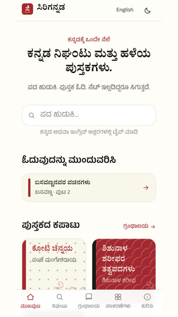
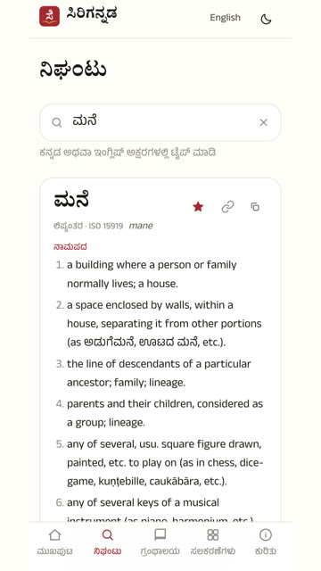
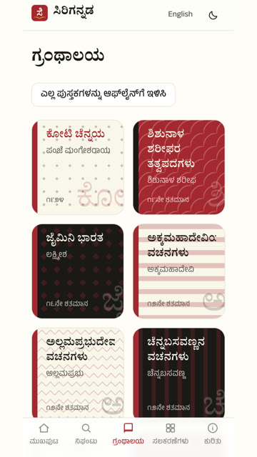

# ಸಿರಿಗನ್ನಡ · Sirigannada

**ಪದದಿಂದ ಪರಂಪರೆಯವರೆಗೆ.**

ಹುಡುಕಿ. ಓದಿ. ಕಲಿಯಿರಿ. ಕನ್ನಡವನ್ನು ಹೊಸದಾಗಿ ಅನ್ವೇಷಿಸಿ.

**ತಾಣ:** [sirigannada.in](https://sirigannada.in)

**From words to heritage.** Search, read, learn, and discover Kannada anew. No account. No ads.

## ಹೇಗೆ ಬಳಸುವುದು · How to use

Open [sirigannada.in](https://sirigannada.in) on a phone or computer. Kannada is the default; tap **English** in the header on a computer, or under **ಇನ್ನಷ್ಟು · More** on a phone, to switch.

[೨೦ ಸೆಕೆಂಡ್ ವೀಡಿಯೊ](https://sirigannada.in/demo.mp4) · home, dictionary, library, Nudi, alphabet.

<video controls playsinline muted width="280" poster="public/screenshots/howto-home.jpg">
  <source src="https://sirigannada.in/demo.mp4" type="video/mp4" />
</video>

<p>
  
  
  
</p>

### ನಿಘಂಟು · Dictionary

1. Tap **ಹುಡುಕು · Search**, or type in the search box on the home page.
2. Search in Kannada (`ಮನೆ`), English (`house`), or Latin letters (`mane`).
3. If nothing matches, tap a suggestion under **ಇದನ್ನೇ ಹುಡುಕುತ್ತಿದ್ದೀರಾ?**.
4. Tap the star (**ಇಷ್ಟಪಟ್ಟಿಗೆ ಸೇರಿಸಿ**) to save a word. Recent searches stay on the empty screen.
5. Share a word with **ಕೊಂಡಿ ನಕಲಿಸಿ** (address looks like `/dictionary?w=ಮನೆ`) or **ಚಿತ್ರ ಹಂಚಿ** for an image card.

The dictionary is [Alar](https://alar.ink) by V. Krishna (ODbL 1.0).

### ಗ್ರಂಥಾಲಯ · Library

1. Tap **ಗ್ರಂಥಾಲಯ**. The first books are ಕೋಟಿ ಚೆನ್ನಯ, ಕರ್ನಾಟಕ ಗತವೈಭವ, ಶಿಶುನಾಳ ಶರೀಫರ ತತ್ವಪದಗಳು, then ಜೈಮಿನಿ ಭಾರತ. There are 20 in all: vachanas, five parvas of ಕುಮಾರವ್ಯಾಸ ಭಾರತ, ಪುರಂದರದಾಸರ ಕೀರ್ತನೆಗಳು, ಸರ್ವಜ್ಞನ ತ್ರಿಪದಿಗಳು and more.
2. Open a book. Use the buttons to turn pages. Tap a word to look it up.
3. Long-press a verse to copy its link or share it as an image card.
4. On the library page, tap **ಎಲ್ಲ ಪುಸ್ತಕಗಳನ್ನು ಆಫ್‌ಲೈನ್‌ಗೆ ಇಳಿಸಿ** to keep every book on the device.
5. Beside the books are two illustrated boxes: **ಚಿತ್ರಕಥೆ** (illustrated Panchatantra tales for readers 16 and over) and **ಕರ್ನಾಟಕ ಇತಿಹಾಸ** (see below).

### ಕರ್ನಾಟಕ ಇತಿಹಾಸ · Karnataka history

True stories of Karnataka's rulers and heroes, told as one story each for someone who has never heard of them: ಮಯೂರಶರ್ಮ, ಇಮ್ಮಡಿ ಪುಲಿಕೇಶಿ, ಇಮ್ಮಡಿ ವಿಕ್ರಮಾದಿತ್ಯ, ಚಾವುಂಡರಾಯ, ಅಮೋಘವರ್ಷ ನೃಪತುಂಗ, ಆರನೇ ವಿಕ್ರಮಾದಿತ್ಯ, ವಿಷ್ಣುವರ್ಧನ, ಕೃಷ್ಣದೇವರಾಯ, ಚಿಕ್ಕದೇವರಾಜ ಒಡೆಯರ್ and ಬೆಳವಡಿ ಮಲ್ಲಮ್ಮ, in nine series from the ಕದಂಬರು to ವೀರ ನಾರಿಯರು.

1. Open **ಗ್ರಂಥಾಲಯ → ಕರ್ನಾಟಕ ಇತಿಹಾಸ** and pick a series, then a story.
2. Each story has a ಪೀಠಿಕೆ (background), twelve or so illustrated scenes, a ಸಾರಾಂಶ, ನಿಮಗೆ ಗೊತ್ತೇ? and ಇಂದು ನೋಡಬಹುದು (what you can visit today).
3. Under each scene, **ಆಧಾರ** shows the inscription or book behind it, by evidence tier. The last page, **ಆಧಾರಗಳು**, lists every source, the points historians still dispute, and, scene by scene, what the story imagined (**ಕಲ್ಪಿತ**: a spoken line, a feeling, a chosen place).

Pictures are AI-made and checked against the period; the story never adds a fact the sources do not give.

Every book lists its author, death year, source, and licence on [ಮೂಲಗಳು](https://sirigannada.in/credits). Only public-domain texts (author died in or before 1965) or permitted Creative Commons works.

### ಕಲಿಕೆ ಮತ್ತು ಪದದಾಟಗಳು · Learning and word games

Open [ಕಲಿಯಿರಿ](https://sirigannada.in/learn) for the alphabet, practice activities, and Kannada word games.

- **ಇಂದಿನ ಪದ · Daily word:** guess one familiar 2–4-akshara Kannada word in six tries. A Kannada conjunct such as `ನ್ನ` occupies one square. Type with your phone/computer keyboard or open the built-in Kannada keyboard. The answer and progress stay on the device, and the explanation is available in Kannada and English.
- **ಪದಬಂಧ · Crossword:** solve multiple clue-based words that cross one another. This is different from the single daily guessing game. The first puzzle uses original bilingual clues and supports hints, answer checking, and local resume.
- **ಗಾದೆ ಪೂರ್ಣ · Finish the proverb:** see the first half of the day's ಗಾದೆ and tap its remaining words into place, with one extra word mixed in. Three tries; words already in the right place stay put after a miss. Share the proverb as an image card when you're done.
- **ಅಭ್ಯಾಸ · Practice:** hear a letter and pick it, name the first letter of a pictured word, match words and meanings, practise ಕಾಗುಣಿತ, and revise saved words with flashcards. The wrong choices sound like the right one (ಡ/ದ, ಲ/ಳ, ಕ ಖ ಗ ಘ). After ten questions, a score card can be shared as an image ("I played … and got 8 out of 10 right!"), made on the device.

The daily word pool, the Padabandha route, and Finish the proverb (built from the proverbs file) are included in offline installation. No score, answer, or learning history is sent anywhere. The home page's **ಇಂದು · Today** box shows how far you are in today's word and crossword, and **ಇಂದಿನ ಗಾದೆ** shows one proverb a day, the same for everyone.

### ಇನ್ನೊಂದು ಸಾಧನದಲ್ಲಿ ಮುಂದುವರಿಸಿ · Continue on another device

Start on a laptop, carry on with a phone or iPad — no account, no login. It is opt-in; the site stays local and offline by default.

- Any verse or page link (`/library/<slug>#b<index>`) opens at the same spot in another browser.
- On the reader (Reading sheet), Padabandha, the daily word, Collections, the alphabet, and inside each practice quiz, tap **ಇನ್ನೊಂದು ಸಾಧನದಲ್ಲಿ ಮುಂದುವರಿಸಿ**. You get a QR and a `sirigannada.in/continue#…` link. Scan or open it on the other device and it resumes your place, in-progress games, and starred words. From the alphabet or a practice quiz it opens the same page or quiz (a fresh round — quiz scores are not saved).

The site has no server, so the whole progress snapshot travels **inside the link** — nothing is uploaded, and the daily-word answer is never included. Links carry their own expiry (about 36 hours), checked against the device's own clock — a convenience against stale links, not a security boundary. Anyone who has the link can mint a valid one, so opening it always shows what it would change before applying anything.

### ಮಕ್ಕಳ ಕಥೆಗಳು · Children's stories

Tap **ಮಕ್ಕಳ ಕಥೆಗಳು** from the home page, the library, or **ಇನ್ನಷ್ಟು · More**. The hub has four sections:

- **ಪಂಚತಂತ್ರ ಕಥೆಗಳು:** illustrated Kannada retellings, each marked with an age band.
- **ಜಾನಪದ ಕಥೆಗಳು:** folk tales from Karnataka and South India, such as ಪುಣ್ಯಕೋಟಿ, with 3D-style pictures.
- **ಕೇಳಿ ಓದಿ:** StoryWeaver picture books with narration, so a child can listen and read along.
- **ಚಿತ್ರಪುಸ್ತಕಗಳು:** picture books to read yourself, with level chips (ಹಂತ ೧ to ೪+), search, and save-all for offline.

### ಆಡಿಯೊ ಕಥೆಗಳು · Audio stories (built, none published yet)

The audio player below is built, but no recording is live: the first set is waiting on a licence, and `/stories` stays empty until one clears.

1. Open `/stories`.
2. Tap ▶ on a story. The mini-player stays at the bottom while you use the rest of the app; the phone's lock screen shows play, pause, and ±15 s.
3. Open the mini-player for the full player: a big play button, −15 s / +15 s, a scrubber, speed (0.8×, 1×, 1.25×), a sleep timer (end of story, 15 or 30 min), and "Stop after this".
4. **ಓದಿ ಕೇಳಿ · Read along** shows the text with the spoken sentence highlighted when a story has sentence timings. Tap a word to see its meaning.
5. **Save all for offline** (or the save cell in the player) keeps the recordings on the phone; saved stories play and seek with no network.

Every recording carries a provenance block with its source, rights holder, and licence. A story whose licence is still being negotiated is listed by title only and never plays from the public site.

**Adding a story (maintainers):** create `data/stories-src/<slug>/story.json` (title, `collection`, `series`, `tags`, `durationSec`, `provenance`), put the recording at `public/data/stories/<slug>.mp3` (mono, 44.1 kHz, 56 kbps is plenty), optionally `text.txt` (one sentence per line) and `timings.json` (start second of each sentence), then run `npm run data:stories`. The build refuses a licensed story without audio and a pending-permission story with audio.

### ಸಲಕರಣೆಗಳು · Tools

From **ಇನ್ನಷ್ಟು · More → ಉಪಕರಣಗಳು**:

| Tool | What it does |
|---|---|
| [ಲಿಪ್ಯಂತರ](https://sirigannada.in/tools/transliterate) | Kannada ↔ ISO 15919 Latin. Needs the dots: `kannaḍa` → ಕನ್ನಡ, not plain `kannada`. |
| [ಅಂಕೆಗಳು](https://sirigannada.in/tools/numbers) | Arabic ↔ Kannada digits, and numbers in words. |
| [ನುಡಿ / ಬರಹ](https://sirigannada.in/tools/convert) | Paste Nudi/Baraha ASCII (`PÀ£ÀßqÀ`) to get Unicode ಕನ್ನಡ. Wrap English in `$...$`. |
| [ವರ್ಣಮಾಲೆ](https://sirigannada.in/learn/alphabet) | Vowels and consonants. Tap a letter to watch it handwritten, hear it spoken, and see everyday words that begin with it, each with a picture; the arrows step through the alphabet. **ಹಂಚಿ** shares the letter as an image or as a short video (the handwriting at its own pace, the sound, the words and pictures), made on the device. Animations and recordings from Wikimedia Commons (CC BY-SA 4.0), credited on the card. |
| [ಗಾದೆಗಳು](https://sirigannada.in/proverbs) | Search 2,000+ folk sayings (CC BY-SA, Kannada Wikiquote). |

### ಚಿತ್ರ ಹಂಚಿ · Share as an image card

A dictionary word, a proverb (**ಗಾದೆ**), the daily word, a library verse, and an alphabet letter each have a **ಚಿತ್ರ ಹಂಚಿ** action that renders a branded 1080×1350 (or 1080×1080) PNG on the device — no upload, no third-party call. The sheet offers download, the native share sheet, copy-image, copy-caption, and copy-link. Text that fails the Nudi/Baraha health check is refused.

### ಆ್ಯಪ್ ಮತ್ತು ಆಫ್‌ಲೈನ್ · Install and offline

On Android Chrome: menu → **Add to Home screen** (or tap **ಆ್ಯಪ್ ಆಗಿ ಸೇರಿಸಿ** on the home page). On iPhone: Share → **Add to Home Screen**.

After it is installed, turn the network off and try ನಿಘಂಟು plus one book. The first dictionary search needs the network once so that shard can cache.

## What is in the app

| | | |
|---|---|---|
| ನಿಘಂಟು | Dictionary | ~1.5 lakh Alar entries |
| ಗ್ರಂಥಾಲಯ | Library | 20 public-domain books, page-turn reader, plus ಚಿತ್ರಕಥೆ |
| ಕರ್ನಾಟಕ ಇತಿಹಾಸ | Karnataka history | 10 illustrated true stories in 9 series, every scene sourced |
| ಕಲಿಕೆ | Learning | Alphabet, practice, daily word game, Padabandha |
| ಸಲಕರಣೆ | Tools | Transliteration, numbers, Nudi conversion, text checks |
| ಗಾದೆಗಳು | Proverbs | 2,000+ searchable Kannada sayings, one on the home page each day |
| ಮಕ್ಕಳ ಕಥೆಗಳು | Children's stories | ಪಂಚತಂತ್ರ and ಜಾನಪದ retellings, ಕೇಳಿ ಓದಿ narrated picture books, and ಚಿತ್ರಪುಸ್ತಕಗಳು to read yourself |
| ಆ್ಯಪ್‌ಗಳು | Apps | Other Sirigannada products on their own subdomains, such as [pu.sirigannada.in](https://pu.sirigannada.in) (`/apps`) |

Code is AGPL-3.0. Original writing is CC BY-SA 4.0. If this site stops, anyone can run it again from the source.

## Contributing

Pull requests are welcome. Work on a **feature branch**, verify it, then open a PR into `main`. Never push to `main`. Every commit needs `git commit -s` (DCO). There is no CLA.

1. Read [CONTRIBUTING.md](CONTRIBUTING.md).
2. Open an issue first for a new book (use the template; death year must be 1965 or earlier for public-domain claims).
3. Fork, one change per PR, `git commit -s`.

Do not copy code or curated data from other Kannada projects.

## Development

```bash
npm install
npm run data        # dictionary + books into public/data
npm run typecheck && npm test
npm run data:validate
npm run dev         # http://localhost:3000
```

Maintainers: `docs/handbook.md` (local) is the internal map.

### Picture-book assets (R2)

Picture-book illustrations and narration are not in git or in the Pages deploy (which is capped at
20,000 files): they live in a Cloudflare R2 bucket served as `https://assets.sirigannada.in`
(`PICTUREBOOK_ASSET_BASE` in `src/lib/assetBase.ts`). `scripts/fetch-storyweaver.ts` writes them
to the git-ignored mirror `assets/picturebooks/<slug>/`, and `npm run data:picturebooks` rewrites
the `/data/picturebooks/<slug>/<file>` paths in `data/picturebooks-src/` to that base. The
service worker learns the base from `/sw.js?assets=…` and caches those files like the rest of
`/data/**`, so saving a book for offline keeps working. To publish a batch:

```bash
aws s3 sync assets/ s3://sirigannada-assets/ --profile r2 \
  --endpoint-url https://<account-id>.r2.cloudflarestorage.com \
  --cache-control "public, max-age=31536000, immutable"
npm run check:assets -- --covers   # then without --covers before merging
```

The bucket needs a CORS rule allowing `GET`/`HEAD` from any origin (preview deploys are on
`*.pages.dev`). Without `assets/` locally, `data:validate` checks the path form only; the bytes are
checked in the bucket by `check:assets`. For an offline test against a local server, build with
`NEXT_PUBLIC_PICTUREBOOK_ASSET_BASE=http://localhost:8787` and serve `assets/` there with CORS
and Range support.

### Canonical host

`www.sirigannada.in` is the canonical host: `metadataBase` in `src/app/layout.tsx`, `SITE_URL` in `src/features/library/lib/siteUrls.ts`, and `CANONICAL_ORIGIN` in `src/features/reader/lib/versePermalink.ts` all point there. `public/_redirects` 301s the apex `sirigannada.in/*` to `www.sirigannada.in/:splat`; Cloudflare Pages applies this at the edge, before any Next.js code runs, so it cannot be exercised locally or in tests — `npm run dev` and the unit tests only check that the rule is present in the file.

### Bundle budget

The offline shell (the `PRECACHE_SHELL` routes in `public/sw.js`, their HTML, the
`/_next/static` JS/CSS/font assets those pages reference, and the manifest + icons) has a
2 MB budget; dictionary shards and other `/data/**` files are fetched on demand and are
excluded. Only core routes are precached at install (home, dictionary, library, proverbs,
games, the children's hub and its two picture-book sections, More, and the offline manager); every other page is
cached the first time it is opened, so recently visited pages work offline and the rest need
the network once. Check the budget after a static build:
`TMPDIR=/tmp npx next build && npm run check:bundle` (pass `--budget <bytes>` to override).
CI fails when the shell is over budget — see `scripts/check-bundle.ts`.

### Analytics

There is no analytics script and no cookie. Visitor numbers (requests, countries, top pages,
referrers, browsers) come from Cloudflare's dashboard for the `sirigannada.in` zone, counted
server-side. [/privacy](https://www.sirigannada.in/privacy) and the Play Store Data safety form
both say so; do not add a tracking script without changing them first.

## Data credits

- **Alar** Kannada–English dictionary © V. Krishna, [ODC-ODbL 1.0](https://opendatacommons.org/licenses/odbl/). [alar.ink](https://alar.ink)
- Books from [Kannada Wikisource](https://kn.wikisource.org). Per-book provenance is in each book file and on `/credits`.
- Proverbs from Kannada Wikiquote, CC BY-SA 4.0.
- Picture books in ಕೇಳಿ ಓದಿ and ಚಿತ್ರಪುಸ್ತಕಗಳು from [StoryWeaver](https://storyweaver.org.in) (Pratham Books and others), CC BY 4.0, credited in each book.
- ಕರ್ನಾಟಕ ಇತಿಹಾಸ rests on published inscriptions and scholarship, listed per story on its ಆಧಾರಗಳು page.

## License

Code: [AGPL-3.0-or-later](LICENSE). Original content and documentation: CC BY-SA 4.0. Third-party data keeps the licence in its `provenance` block.

## ಮಕ್ಕಳ ಕಥೆಗಳು · Children’s stories

**ಮಕ್ಕಳ ಕಥೆಗಳು** (desktop header, home shelf, and **ಇನ್ನಷ್ಟು · More**) opens one hub with four
sections, in the order of `data/children-src/collections.json`: **ಪಂಚತಂತ್ರ ಕಥೆಗಳು** and **ಜಾನಪದ
ಕಥೆಗಳು** (illustrated Kannada retellings), **ಕೇಳಿ ಓದಿ** (StoryWeaver picture books that have
narration, so a child can listen and read along), and **ಚಿತ್ರಪುಸ್ತಕಗಳು** (the picture books without
narration). Both picture-book sections share the same ಎಲ್ಲ · ಹಂತ ೧ · ೨ · ೩ · ೪+ level chips, search,
Continue card and save-all. A book’s back button returns to the section it belongs to. New sections
are added to `collections.json`; a `stories` section needs its own folder, a `picturebooks` section
only its `narrated` flag. A `stories` section with `audience: "adults"` (ಚಿತ್ರಕಥೆ) is shown in the
library instead of the children's hub. Retellings keep the source's plot and ending; an unsettling
tale gets an older age band (2+, 8+, 10+, 12+, 16+) rather than a softened ending.

To add the next illustrated story, follow the tracked [production playbook](data/children-src/README.md),
[illustration recipe](data/children-src/ILLUSTRATIONS.md), and
[review checklist](data/children-src/REVIEW.md). Text and illustrations require a recorded
coordinator or agent review before a GitHub push. `npm run data:children` checks the content
and binds approval to the exact story and image files.

## ಕರ್ನಾಟಕ ಇತಿಹಾಸ · Karnataka history

A second non-book box in **ಗ್ರಂಥಾಲಯ**, beside ಚಿತ್ರಕಥೆ: `/library/karnataka-itihasa` lists the series
from `data/history-src/collections.json`, `/library/karnataka-itihasa/<series>` lists that series'
stories, and `/library/karnataka-itihasa/<series>/<story>` is the immersive reader (title page,
ಪೀಠಿಕೆ, one 16:9 picture per scene with its ಆಧಾರ by evidence tier, ಸಾರಾಂಶ, ನಿಮಗೆ ಗೊತ್ತೇ?, ಇಂದು
ನೋಡಬಹುದು, ಆಧಾರಗಳು). A story is `data/history-src/<series>/<story>/story.json` (contract in
`src/features/history/types.ts`) with its pictures under `public/history/<series>/<story>/`; a
folder without a `story.json` is work in progress and is not published. `npm run data:history`
validates the contract, the fact ids behind every scene, picture size and ratio, and the
`review.json` hashes, following the [production plan](data/history-src/README.md).

Every story is written to the plan's storytelling template (§6: one spine, at most five names and
five dates in the prose, the turning point at scene 9 to 11) and must pass its newcomer test (§7).
Each one also needs an independent review recorded in `review.json` before it ships. Facts come
only from `facts.json` and the research files in `data/history-src/research/`; anything imagined is
disclosed in the scene's `dramatised` list. Each story gets its own PR straight to `main` (no
stacked PRs). The matching video screenplays, character sheets and renders are kept outside this
repository.
